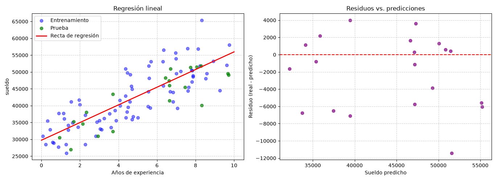

# Regresión lineal: experiencia vs. sueldo

Proyecto didáctico de **regresión lineal simple** con Python y scikit-learn. Se generan datos sintéticos (años de experiencia vs. sueldo mensual), se entrena un modelo, se evalúa con métricas estándar y se visualiza el resultado.

## Resultado



- **Izquierda:** datos de entrenamiento (azul), datos de prueba (verde) y la recta de regresión (roja).
- **Derecha:** residuos (real − predicho). Se distribuyen de forma aleatoria alrededor de 0, señal de que una recta es un modelo adecuado para estos datos.

## Cómo funciona

1. **Datos sintéticos:** `sueldo = 2500 × años + 30000 + ruido`, con 100 muestras.
2. **División:** 80% entrenamiento y 20% prueba.
3. **Entrenamiento:** `LinearRegression` de scikit-learn aprende la pendiente y el intercepto.
4. **Evaluación:** MSE, RMSE y R² sobre los datos de prueba.
5. **Visualización:** ajuste del modelo y gráfico de residuos con matplotlib.

## Resultados obtenidos

| Parámetro  | Real   | Estimado |
|------------|--------|----------|
| Pendiente  | 2,500  | ≈ 2,623  |
| Intercepto | 30,000 | ≈ 29,744 |

| Métrica | Valor    | Significado                                      |
|---------|----------|--------------------------------------------------|
| MSE     | ≈ 21.5 M | Error cuadrático medio (menor es mejor)          |
| RMSE    | ≈ 4,633  | Error típico, en las mismas unidades del sueldo  |
| R2      | ≈ 0.656  | Proporción de la variación que explica el modelo |

> El R2 es moderado porque el ruido (5,000) es grande frente al efecto de la experiencia. Con `RUIDO = 1000` sube a más de 0.95.

## Requisitos

- Python 3.10 o superior
- numpy
- matplotlib
- scikit-learn

## Instalación

```bash
# (Opcional) crear entorno virtual
python -m venv venv
venv\Scripts\activate        # Windows
# source venv/bin/activate   # macOS / Linux

# Instalar dependencias
python -m pip install numpy matplotlib scikit-learn
```

## Uso

```bash
python regresion_lineal.py
```

Se imprimen en consola los parámetros y las métricas, y se abre una ventana con las gráficas. Cierra la ventana para terminar el programa.

## Estructura del proyecto

```
Regresion_lineal/
├── regresion_lineal.py    # script principal
├── modelo-regresio.png    # imagen del resultado
└── README.md
```

## Personalización

Al inicio del script puedes modificar:

```python
PENDIENTE_REAL = 2500     # cuánto sube el sueldo por año de experiencia
INTERCEPTO_REAL = 30000   # sueldo base
RUIDO = 5000              # dispersión de los datos
```

Para predecir un caso nuevo (por ejemplo, 5 años de experiencia):

```python
print(modelo.predict([[5]]))
```

## Próximos pasos

- Regresión lineal múltiple (más variables: estudios, ciudad, etc.).
- Usar un conjunto de datos real en lugar de datos sintéticos.
- Comparar con otros modelos (Ridge, Lasso, árboles de decisión).
